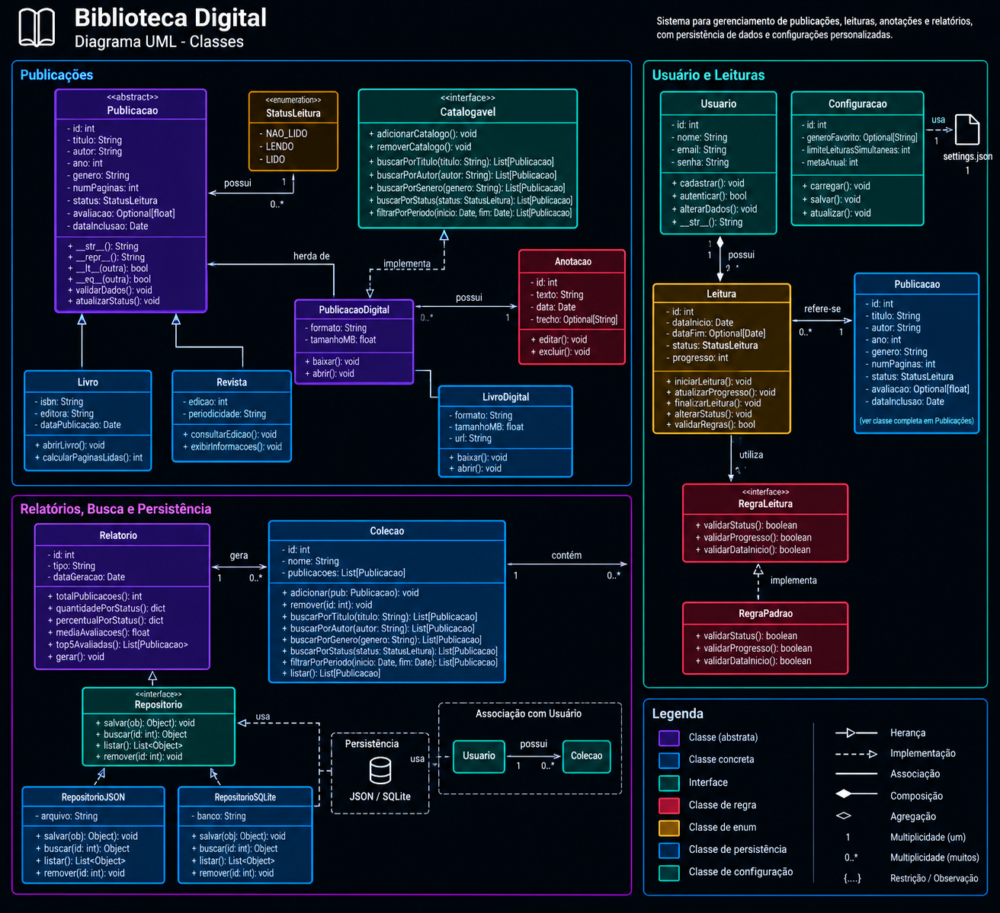

# 📚 Sistema de Biblioteca Pessoal/Digital

Sistema desenvolvido em **Python**, com foco em **Programação Orientada a Objetos (POO)**, para gerenciar uma biblioteca pessoal por meio de uma interface de linha de comando (CLI).

A aplicação permite organizar publicações, acompanhar leituras, registrar anotações, criar coleções e consultar relatórios, utilizando arquivos JSON para persistência dos dados.

---

## 📌 Sumário

- [Sobre o projeto](#-sobre-o-projeto)
- [Objetivos](#-objetivos)
- [Funcionalidades](#-funcionalidades)
- [Diagrama UML](#-diagrama-uml)
- [Arquitetura do sistema](#-arquitetura-do-sistema)
- [Principais classes](#-principais-classes)
- [Persistência de dados](#-persistência-de-dados)
- [Tecnologias utilizadas](#-tecnologias-utilizadas)
- [Como executar](#-como-executar)
- [Comandos da CLI](#-comandos-da-cli)
- [Testes automatizados](#-testes-automatizados)
- [Estrutura do projeto](#-estrutura-do-projeto)
- [Autor](#-autor)

---

## 🎯 Sobre o projeto

O Sistema de Biblioteca Pessoal/Digital tem como finalidade facilitar a organização de uma biblioteca individual, permitindo gerenciar informações sobre publicações e acompanhar o relacionamento do usuário com suas leituras.

O projeto foi desenvolvido aplicando conceitos de Programação Orientada a Objetos, com classes organizadas por responsabilidade, validação de dados, relacionamentos entre objetos e separação entre a interface de interação e a persistência.

A aplicação utiliza uma CLI (*Command-Line Interface*), na qual o usuário digita comandos em um terminal para acessar as funcionalidades do sistema.

## 🎓 Objetivos

- Aplicar os fundamentos da Programação Orientada a Objetos.
- Organizar diferentes tipos de publicações por meio de herança e abstração.
- Gerenciar informações e estados de leitura.
- Permitir a criação e manutenção de anotações e coleções.
- Disponibilizar consultas, filtros e relatórios.
- Implementar persistência de dados utilizando JSON.
- Desenvolver uma aplicação modular, organizada e testada.

## ✨ Funcionalidades

### 📖 Gerenciamento de publicações

- Cadastrar publicações.
- Listar as publicações registradas.
- Buscar publicações pelo identificador.
- Remover publicações.
- Filtrar publicações por status de leitura ou gênero.
- Ordenar publicações pelo título.
- Trabalhar com livros, revistas e publicações digitais.

### 📚 Acompanhamento de leituras

O sistema possui classes destinadas à representação e ao acompanhamento das leituras, incluindo:

- Data de início.
- Data de término.
- Status de leitura.
- Percentual de progresso.
- Validação de dados relacionados ao progresso.
- Regras para validar o progresso da leitura.

### 📝 Gerenciamento de anotações

As anotações podem ser associadas às publicações e utilizadas para registrar informações relevantes durante a leitura.

Funcionalidades disponíveis:

- Criar uma anotação para uma publicação.
- Listar as anotações de uma publicação.
- Editar uma anotação existente.
- Excluir uma anotação.
- Registrar texto, data e trecho opcional.

### 🗂️ Gerenciamento de coleções

As coleções permitem organizar publicações em grupos.

O sistema oferece:

- Criar coleções.
- Listar coleções.
- Consultar uma coleção pelo identificador.
- Adicionar publicações a uma coleção.
- Remover publicações de uma coleção.

A classe `Colecao` também disponibiliza operações de consulta e filtragem das publicações, conforme os métodos implementados.

### 📊 Relatórios

O módulo de relatórios permite obter informações estatísticas sobre a biblioteca, incluindo:

- Quantidade de publicações.
- Distribuição das publicações por status.
- Percentual por status.
- Média das avaliações.
- Publicações mais bem avaliadas.

### 💾 Armazenamento de dados

- Persistência utilizando arquivos JSON.
- Conversão de objetos para dicionários.
- Reconstrução de objetos a partir dos dados armazenados.
- Organização do armazenamento em módulos específicos.

---

## 🧩 Diagrama UML

O diagrama UML representa a estrutura do projeto e seus principais elementos, incluindo classes, atributos, métodos e relacionamentos.

**Visualizar o diagrama UML:**

[📎 Clique aqui para abrir o diagrama UML (UML.png)](./UML.png)



O diagrama auxilia na compreensão da arquitetura do sistema, especialmente das relações de herança e das responsabilidades das classes.

## 🏗️ Arquitetura do sistema

O projeto está organizado em módulos para separar as responsabilidades e facilitar a manutenção do código.

| Módulo | Responsabilidade |
|---|---|
| `publicacoes/` | Publicações, anotações, coleções e elementos relacionados. |
| `usuarios/` | Classes de usuário e configurações. |
| `leituras/` | Representação das leituras e regras de validação. |
| `relatorios/` | Geração de estatísticas da biblioteca. |
| `repositorio/` | Interfaces e implementações relacionadas à persistência. |
| `tests/` | Testes automatizados. |
| `dados/` | Armazenamento local dos dados JSON. |
| `main.py` | Inicialização e interface CLI da aplicação. |
| `UML.png` | Diagrama UML do projeto. |

Essa divisão permite que cada módulo concentre suas responsabilidades, evitando que toda a lógica do sistema fique reunida em um único arquivo.

## 🧱 Principais classes

### Publicações

| Classe | Descrição |
|---|---|
| `Publicacao` | Classe abstrata que representa os dados e comportamentos comuns das publicações. |
| `Livro` | Representa livros físicos. |
| `Revista` | Representa revistas e periódicos. |
| `PublicacaoDigital` | Representa publicações digitais. |
| `LivroDigital` | Especialização de `PublicacaoDigital`. |
| `Catalogavel` | Define operações relacionadas à catalogação e à busca. |
| `StatusLeitura` | Enumeração utilizada para representar estados de leitura. |

### Anotações e coleções

| Classe | Descrição |
|---|---|
| `Anotacao` | Representa anotações vinculadas a publicações. |
| `Colecao` | Organiza publicações em grupos e oferece operações de consulta. |

### Usuários e leituras

| Classe | Descrição |
|---|---|
| `Usuario` | Representa o usuário e seus dados. |
| `Configuracao` | Representa as preferências e configurações do usuário. |
| `Leitura` | Representa o acompanhamento de uma leitura. |
| `RegraLeitura` | Classe base para regras relacionadas à leitura. |
| `RegraPadrao` | Implementa a validação padrão do progresso de leitura. |

### Relatórios e persistência

| Classe ou módulo | Descrição |
|---|---|
| `Relatorio` | Calcula e apresenta estatísticas da biblioteca. |
| `Repositorio` | Define operações gerais de persistência. |
| `RepositorioJSON` | Implementa o armazenamento em arquivos JSON. |
| `RepositorioColecoes` | Responsável pela persistência das coleções. |
| `RepositorioAnotacoes` | Responsável pela persistência das anotações. |

## 🔗 Conceitos de Programação Orientada a Objetos

O desenvolvimento do projeto aplica conceitos fundamentais de POO:

- **Encapsulamento:** organização e proteção dos atributos por meio dos mecanismos definidos nas classes.
- **Herança:** reutilização e especialização de comportamentos entre classes relacionadas.
- **Abstração:** representação de estruturas comuns por meio de classes abstratas e contratos de comportamento.
- **Polimorfismo:** utilização de uma estrutura comum para trabalhar com diferentes tipos de publicação.
- **Enumerações:** representação dos estados de leitura por valores definidos.
- **Validação:** verificação dos dados recebidos pelos objetos.
- **Métodos especiais:** personalização de comportamentos de objetos quando implementada pelas classes.
- **Persistência:** armazenamento e recuperação dos dados da aplicação.
- **Testes automatizados:** verificação do funcionamento das classes e dos componentes implementados.

## 💾 Persistência de dados com JSON

O sistema utiliza arquivos JSON para armazenar e recuperar informações da biblioteca.

O módulo `RepositorioJSON` centraliza as operações de persistência, permitindo salvar e carregar dados sem concentrar toda a lógica de armazenamento na interface CLI.

A conversão de objetos para dicionários facilita a serialização, enquanto a reconstrução de objetos permite recuperar as informações armazenadas.

Os módulos de persistência de coleções e anotações complementam essa organização.

Os dados locais são armazenados no diretório `dados/`, que é ignorado pelo Git conforme a configuração do `.gitignore`.

**Observação:** o projeto possui um arquivo chamado `repositorio_sqlite.py`, mas o SQLite não está integrado ao fluxo atual da aplicação. Por isso, ele não é apresentado como uma tecnologia efetivamente utilizada pelo sistema.

## 🛠️ Tecnologias utilizadas

- **Python:** linguagem de programação utilizada no desenvolvimento.
- **JSON:** formato utilizado para persistência dos dados.
- **CLI:** interface de linha de comando para interação com o usuário.
- **pytest:** ferramenta utilizada para executar os testes automatizados.
- **Git:** controle de versão do código.
- **GitHub:** hospedagem e gerenciamento do repositório.
- **UML:** modelagem visual da estrutura do sistema.

## ▶️ Como executar

### 1. Clonar o repositório

```bash
git clone https://github.com/Gledsons7/SISTEMA_DE_BIBLIOTECA_PESSOAL_GLEDSON_DO_NASCIMENTO_SILVA.git
```

### 2. Entrar na pasta do projeto

```bash
cd SISTEMA_DE_BIBLIOTECA_PESSOAL_GLEDSON_DO_NASCIMENTO_SILVA
```

### 3. Iniciar a aplicação

```bash
python main.py
```

Após a inicialização, o sistema disponibiliza uma interface de comandos no terminal, utilizando o prompt:

```text
biblioteca>
```

Digite `ajuda` para visualizar os comandos disponíveis.

> **Requisito:** ter Python instalado e disponível no terminal. Dependendo do ambiente, pode ser necessário utilizar `python3` em vez de `python`.

## 💻 Comandos da CLI

A aplicação permite interagir com as funcionalidades por meio de comandos digitados no terminal.

| Comando | Descrição |
|---|---|
| `ajuda` | Exibe a lista de comandos disponíveis. |
| `cadastrar` | Inicia o cadastro de uma publicação. |
| `listar` | Lista as publicações registradas. |
| `buscar ID` | Busca uma publicação pelo identificador. |
| `remover ID` | Remove uma publicação. |
| `filtrar status STATUS` | Filtra publicações pelo status de leitura. |
| `filtrar genero NOME` | Filtra publicações pelo gênero. |
| `ordenar titulo` | Ordena as publicações por título. |
| `relatorio` | Exibe estatísticas da biblioteca. |
| `colecao criar NOME` | Cria uma coleção. |
| `colecao listar` | Lista as coleções. |
| `colecao ver ID` | Consulta uma coleção. |
| `colecao adicionar ID ID_PUB` | Adiciona uma publicação a uma coleção. |
| `colecao remover ID ID_PUB` | Remove uma publicação de uma coleção. |
| `anotacao criar ID_PUB` | Cria uma anotação para uma publicação. |
| `anotacao listar ID_PUB` | Lista as anotações de uma publicação. |
| `anotacao editar ID` | Edita uma anotação. |
| `anotacao excluir ID` | Exclui uma anotação. |
| `sair` | Encerra a aplicação. |

Os comandos com identificadores utilizam os valores correspondentes aos registros existentes. Para consultar a sintaxe disponível no próprio programa, utilize `ajuda`.

## 🧪 Testes automatizados

O projeto utiliza `pytest` para verificar o comportamento das classes, a conversão de dados e os componentes de persistência contemplados pelos testes.

Para executar a suíte de testes, utilize:

```bash
python -m pytest -q
```

**Último resultado confirmado durante o desenvolvimento:**

```text
33 passed
```

Isso significa que os 33 testes passaram na última execução registrada. O resultado poderá mudar caso o código ou os testes sejam modificados.

## 📁 Estrutura do projeto

```text
SISTEMA_DE_BIBLIOTECA_PESSOAL_GLEDSON_DO_NASCIMENTO_SILVA/
│
├── publicacoes/
│   ├── publicacao.py
│   ├── livro.py
│   ├── revista.py
│   ├── publicacao_digital.py
│   ├── livro_digital.py
│   ├── anotacao.py
│   ├── colecao.py
│   ├── catalogavel.py
│   └── status_leitura.py
│
├── usuarios/
│   ├── usuario.py
│   └── configuracao.py
│
├── leituras/
│   ├── leitura.py
│   ├── regra_leitura.py
│   └── regra_padrao.py
│
├── relatorios/
│   └── relatorio.py
│
├── repositorio/
│   ├── repositorio.py
│   ├── repositorio_json.py
│   ├── repositorio_sqlite.py
│   ├── repositorio_colecoes.py
│   └── repositorio_anotacoes.py
│
├── tests/
│   ├── test_publicacao.py
│   ├── tests_conversao.py
│   └── test_repositorio.py
│
├── dados/              # Armazenamento local, ignorado pelo Git
├── main.py
├── UML.png
├── .gitignore
└── README.md
```

## 👨‍💻 Autor

**Gledson do Nascimento Silva**

Projeto acadêmico desenvolvido com foco em Programação Orientada a Objetos, organização de código, persistência de dados e testes automatizados.

---

⭐ **Sistema de Biblioteca Pessoal/Digital** — organização e gerenciamento de publicações, coleções, anotações e leituras em uma única aplicação.